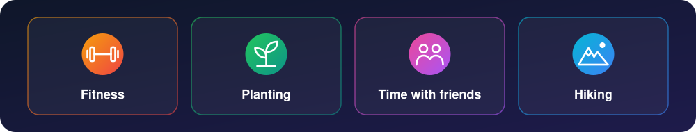

  

  
  
  

## About me

I'm a senior full-stack web developer and AI engineer with an MSc in Software Engineering. I have built web applications since 2010 for research, banking, payments and telecommunications, and today I develop the web applications of the Max Planck Institute for Intelligent Systems.

Since 2025 I have also worked as an AI solutions developer alongside that role. I set up the team's AI assistant and build custom AI agents, train colleagues to use them, and connect our web applications directly to large language models (LLMs) so that end users get their work done faster.

## AI work

  

- **LibreChat for the team:** set up and rolled out LibreChat as the team's AI assistant, connected to models hosted on Azure and to in-house models.
- **Agents and orchestration:** built agents and agent orchestration in LibreChat, extended with MCP servers and actions. I talk with colleagues about their recurring tasks and build new agents for them.
- **AI features in web apps:** connected our web applications to LLMs for automation and AI-based features. One of them extracts data from documents and fills in forms automatically.
- **Web MCP:** exposing a web application's functionality as Model Context Protocol tools so AI agents can use it.
- **AI-assisted development:** Claude Code and GitHub Copilot are part of my daily development work.
- **Workshop:** ran a workshop that taught colleagues how to work with AI.

## Experience

  

<b>Max Planck Institute for Intelligent Systems</b>, Tübingen · Software Engineer Web Development · since Nov 2020

- Web application for managing third-party contracts, built with Next.js, NextAuth, ldapjs, Prisma and Docker.
- Science Hub, the collaboration between Amazon and the Max Planck Society, with Next.js and GraphQL on a Ruby on Rails back end.
- Web application for managing information on current employees and alumni.
- Websites for the institute's 100-year anniversary and the AI Breakthrough Hub event.
- Development and maintenance of further institute websites, including [is.mpg.de](https://is.mpg.de), IMPRS-IS, ELLIS and CLS.

<b>DFA Corporation</b> (core banking), Tehran · Software Engineer Web Development · Feb 2019 – Sep 2020

- IRMA (Integrated Remote Monitoring Administration), a system for managing more than 15,000 ATMs, POS terminals and banking kiosks, built with ASP.NET Core, React, C#, SQL Server and EF Core.
- New responsive user interfaces for payment system monitoring, kiosk terminals and ATMs.
- Offline map showing the status of financial terminals across the country, using Leaflet and a map server in Docker.

<b>Behpardakht Mellat</b> (payment service provider), Tehran · Front-End Engineer · Dec 2018 – Feb 2019

- Front end of a national fuel project with React, Redux and Bootstrap.

<b>MobinNet Telecom</b>, Tehran · Front-End Engineer · Apr 2016 – Dec 2018

- Customer portal my.mobinnet.ir for a nationwide broadband operator, built for high traffic and many concurrent users; it contributed to a 40% increase in sales revenue.
- Further web projects with React, ES6, Bootstrap, jQuery, Razor and Handlebars.

<b>Tehran Institute of Technology</b> · Teacher · May 2013 – Jan 2016

- Taught the CIW web design courses (HTML, CSS, Bootstrap, JavaScript, jQuery, Photoshop) as well as C#, ASP.NET and C++.

<b>Pars Fanavaran</b>, Tehran · Software Engineer Web Development · Mar 2010 – Apr 2013

- Web applications with ASP.NET Web Forms across all layers, from the database to services to the user interface.

## Tech stack

**AI**

**Front end**

**Back end and data**

**Tools and methods**

## Education and publication

- **MSc in Software Engineering**, Azad University, 2013–2015
- **Publication:** [On Complexity of Persian Orthography: L-Systems Approach](https://www.complex-systems.com/abstracts/v25_i02_a03/), *Complex Systems* 25(2), 2016

## Languages

## Outside work

  

## Contact

- **Email:** [nassim_taghipoor@yahoo.com](mailto:nassim_taghipoor@yahoo.com)
- **LinkedIn:** [nassimtaghipour](https://www.linkedin.com/in/nassimtaghipour)
